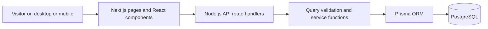

# OneAtlas internship assignment: final implementation plan

## 1. Goal and role

Build a working MVP that lets developers discover, inspect, compare, and evaluate AI models across providers. Choose **Full Stack Engineer** as the single submission role. The product must demonstrate frontend and backend integration, a real database, and a live deployment.

This is a catalog and comparison product. It does not need to run models, issue API keys, process payments, or implement AI routing.

## 2. Required stack and simple architecture

- **Frontend:** Next.js App Router, React, TypeScript, Tailwind CSS.
- **Backend:** Node.js and TypeScript, using Next.js Route Handlers under `app/api/`. This is the PDF's Next.js API option; no separate server is needed.
- **Database:** PostgreSQL with Prisma ORM and migrations.
- **Deployment:** Next.js on Vercel and PostgreSQL on Neon, both among the PDF's preferred services.
- **Repository:** One GitHub repository for the application, Prisma schema, seed script, and README.

The database is the source of truth. Pages request data through the application's APIs. Search and filter choices are stored in the URL so results can be shared and reloaded. The APIs validate inputs, query Prisma, and return JSON. The UI shows loading, empty, and error states.

## 3. Pages and user workflow

| Page | What the visitor does |
| --- | --- |
| `/` or `/models` | Search and browse models; filter by company, provider, capability, and model type; sort by price, context window, or release date. |
| `/models/[slug]` | Read a model's overview, specifications, input/output prices, context window, modalities, capabilities, provider availability, and benchmark scores. |
| `/compare?ids=...` | Select 2-3 models and compare price, context, capabilities, and benchmark scores in columns. |
| `/rankings` | Choose a model category and benchmark, then view models ranked by that benchmark's score. |
| `/labs` and `/labs/[slug]` | Browse AI companies/research labs, their models, and release dates. |
| `/providers` and `/providers/[slug]` | Browse providers and see which models each offers and at what price. |

**Typical journey:** A visitor searches for a model, applies filters, opens its detail page, adds it to comparison, checks a benchmark ranking, and visits a provider page to see availability. Global search and navigation make these pages reachable from anywhere. Layouts must work on mobile and desktop.

## 4. Data model

Keep the schema small and relational:

- `Lab`: name, slug, description, website.
- `Provider`: name, slug, description, website.
- `Model`: name, slug, lab ID, description, type/category, release date, context window, output limit, modalities, capabilities, and status.
- `ModelOffering`: model ID, provider ID, input price and output price per 1 million tokens, currency, and last checked date. This allows one model to have different prices at different providers.
- `Benchmark`: name, category, score unit, and whether higher scores are better.
- `BenchmarkResult`: model ID, benchmark ID, score, and source/as-of date.

Use unique slugs and database indexes for the fields used most often in filtering and sorting. Allow unknown prices or scores to be empty and show “Not available” in the UI. Rankings use one selected benchmark at a time; do not combine unrelated scores into a made-up overall rating.

Start with roughly 20-30 representative models, several labs and providers, and a few benchmarks. The PDF allows mock or generated data, but seed it through Prisma into PostgreSQL and label illustrative values clearly. Record sources and as-of dates for any real prices or benchmark results. No frontend-only data arrays.

## 5. API contract

All endpoints are read-only for this MVP:

| Endpoint | Purpose |
| --- | --- |
| `GET /api/models` | Search, filters, sorting, and pagination. |
| `GET /api/models/[slug]` | Full model details and related offerings/results. |
| `GET /api/compare?ids=...` | Data for 2-3 selected models. |
| `GET /api/rankings` | Ranked results for a selected category and benchmark. |
| `GET /api/labs` and `GET /api/labs/[slug]` | Lab directory and lab models. |
| `GET /api/providers` and `GET /api/providers/[slug]` | Provider directory and supported models. |

Validate filter values, sort keys, page size, and model IDs. Return consistent JSON and appropriate errors for invalid requests or missing records. Keep pagination on the server so the entire catalog is not sent to the browser.

## 6. Build order

1. **Review references and define the UI:** Study OneAtlas, OpenRouter, RouterPlus, and LiteLLM for discovery, pricing, providers, and developer workflows. Sketch the six page types above. Use them for product ideas, not as designs to copy.
2. **Create the app:** Initialize Next.js with TypeScript and Tailwind. Configure Prisma and PostgreSQL. Add environment variable examples and a README.
3. **Create and seed the database:** Implement the six tables, migrations, and repeatable seed script. Check the seeded relationships and missing-value handling.
4. **Build the APIs:** Start with model list and detail, then comparison, rankings, labs, and providers. Add validation, pagination, and error responses.
5. **Build the UI:** Implement discovery first, then detail, comparison, rankings, and directories. Reuse navigation, model cards/rows, filter controls, and tables.
6. **Verify the full journey:** Check search/filter/sort combinations, detail links, comparison selections, ranking order, directory relationships, empty/error states, and mobile layouts. Run lint, type check, and build.
7. **Deploy and submit:** Deploy the database and app, apply migrations and seed data, then repeat the main user journey on the live URL. Push the repository and record a 5-10 minute Loom walkthrough explaining architecture, features, decisions, and challenges. Submit the live URL, GitHub URL, and Loom URL through the form in the assignment.

## 7. Definition of done

- All six product requirement areas in the PDF are reachable and functional.
- Data is stored in PostgreSQL and accessed through Node.js APIs; the UI is not a hardcoded demo.
- Search, filters, sorting, comparison, rankings, labs, and provider pages work with the seeded data.
- The app is responsive and handles loading, empty, and error cases.
- The public deployment works, and the repository explains setup, architecture, data limitations, and deployment.
- The Loom video and submission links are ready.

## 8. Deliberate MVP limits

Skip accounts, admin dashboards, automatic scraping, live price syncing, model inference, payment features, and complex ranking algorithms. These are not required by the PDF and would distract from a complete, explainable MVP. AI coding assistants are allowed, but the PDF prohibits prompt-to-app generators such as Lovable, Bolt.new, and Base44. Be prepared to explain every part of the implementation.

## Assignment and reference links

- Assignment PDF: `C:\Users\Tejas Kharade\Downloads\AI Software Engineer Internship.pdf`
- Product: https://oneatlas.dev/
- References: https://openrouter.ai/ , https://routerplus.com/ , https://www.litellm.ai/
- Submission form: https://forms.gle/oDQ6ucjpiFaZtCGL9
- Route Handler documentation: https://nextjs.org/docs/app/getting-started/route-handlers
- Prisma and Next.js guide: https://www.prisma.io/docs/guides/frameworks/nextjs